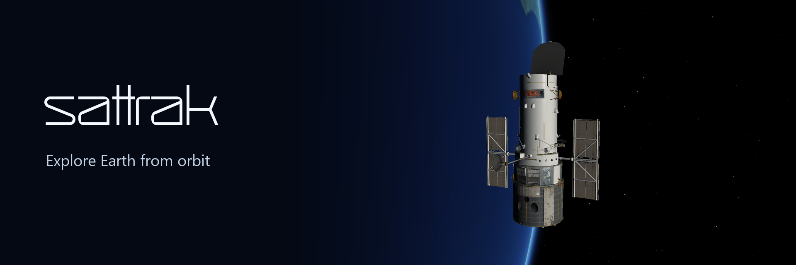
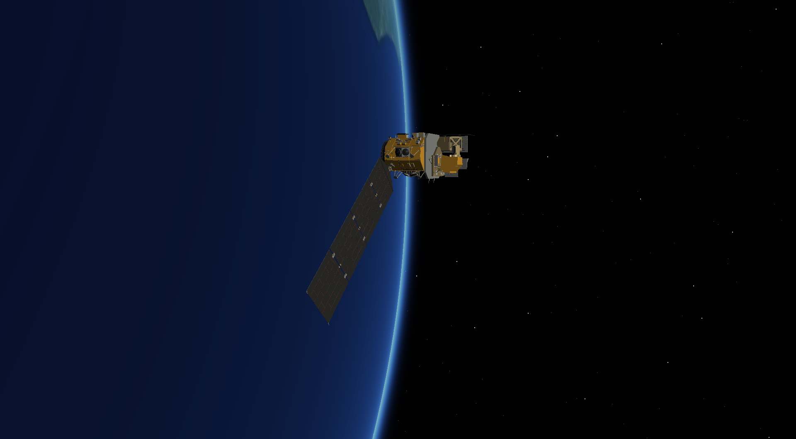
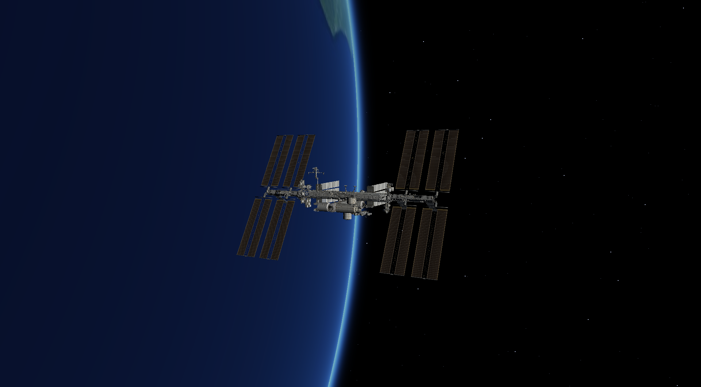
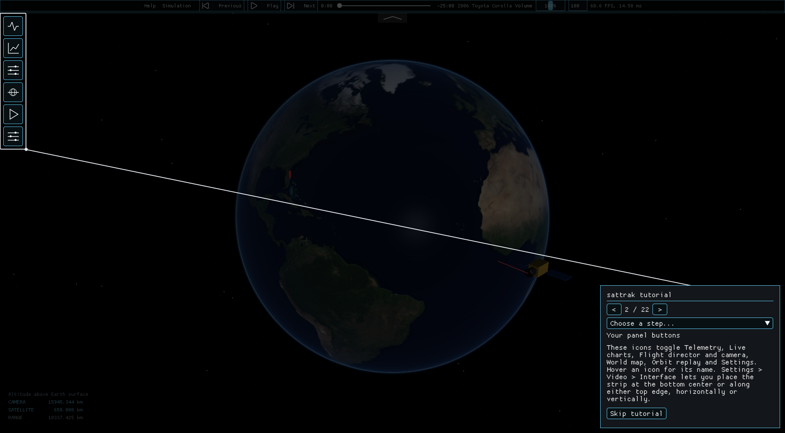
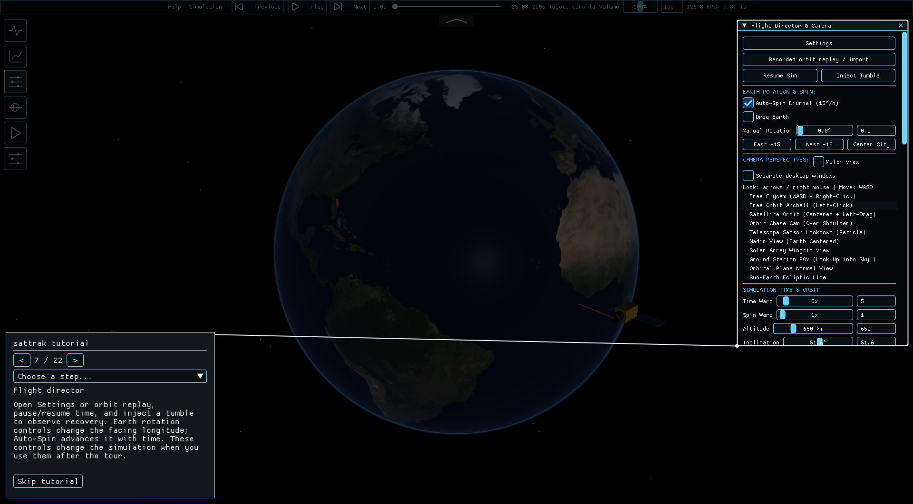

# sattrak

**[Download for Windows](https://github.com/ExplodingWater/sattrak/releases/download/v1.0.0-preview.20261103/sattrak-1.0.0-windows-x64-setup.exe)** · [Release notes](https://github.com/ExplodingWater/sattrak/releases/tag/v1.0.0-preview.20261103) · [Screenshot tutorial](docs/TUTORIAL.md)

The Windows preview includes the branded installation wizard, bundled models and offline satellite catalog. Install for your Windows account, then follow the guided first-run tutorial. Restart it any time from **Settings → General → Restart guided tutorial**.

sattrak is a desktop satellite simulator for exploring Earth from orbit. Follow a spacecraft, fly around it, watch its path across the globe, or see a pass from a ground station. It started as a personal aerospace project and is still growing.

Built by **Martin Hafizi ([ExplodingWater](https://github.com/ExplodingWater))**. Made with love.

<p>
  
  
</p>

All imagery above comes from sattrak's own renderer. See [branding and capture notes](docs/BRANDING.md).

## Learn the interface

<p>
  
  
</p>

The 22-step walkthrough opens and spotlights each main part of the UI. Use **< current / total >**, jump with **Choose a step…**, or **Skip tutorial** at any time. The final step has **Finish tutorial**. [See the full screenshot guide](docs/TUTORIAL.md) for orbit import, recording, settings and the shock explorer.

## What you can do

- Explore a 3D Earth with spacecraft models including Landsat 8, Hubble, Terra, GOES-R and the ISS.
- Switch between camera views, fly freely, or use multiple views at once.
- Try realistic relative scale and real-time motion in 1:1 mode.
- Watch attitude, telemetry and ground tracks while adjusting the simulation.
- Import an orbit, replay it, compare paths and inspect ground-station passes.
- Record your own simulated path and save it as a CSV.
- Experiment with spacecraft properties, sensors, orbital forces and pointing controls.
- Explore supersonic airflow in the separate CFD view.

Optional music and recorded amateur-radio communications accompany the view. Their volume and playback can be controlled independently. The app works offline; optional internet updates refresh the satellite catalog used for orbit predictions.

The night sky uses 5,044 catalog stars with J2000 positions, brightness and approximate colors. Enable constellation lines and names under **Settings → Video → Night sky**. See [sky controls and accuracy limits](docs/NIGHT_SKY.md).

## Get started

Windows builds are available under [Releases](https://github.com/ExplodingWater/sattrak/releases). If a setup executable is provided, run it to install for your Windows account. For portable ZIPs, extract the whole archive and run **ag.exe**, keeping `assets/` and `earth_texture.jpg` beside it. Releases marked **Pre-release** are development previews.

Use **Flight Director & Camera** to choose a view and open **Settings**. Move over the 3D view with **WASD**, hold the **right mouse button** or use the **arrow keys** to look around, and scroll to zoom. **Satellite Orbit** keeps the spacecraft in the center while you rotate around it. Hover over controls for explanations.

The orbit window contains **Record path**, **Stop recording**, **Save** and **Save As...**. Save writes to `local/recordings` under the launch folder. Starting another recording or exiting discards unsaved work; saved files remain. See the [orbit file guide](assets/orbits/README.md) for supported imports. Invalid CSV imports show a line-specific error and preserve the previously loaded primary and comparison paths.

Press **backtick (`)** for the command console. Use Up/Down to select suggestions and Tab to complete them. For example, `radio.play 01` plays the first recording in `assets/radio`, and `radio.stop` stops radio playback.

Type `help` for available commands. You can adjust simulation speed, camera sensitivity and field of view, orbit altitude and inclination, master volume and UI scale. Suggestions appear as you type, and entering a value command without its argument shows its range and default. The console works while Settings and orbit replay are open.

Music volume uses the same line-and-thumb bar as the song timeline; the adjacent
numeric field still accepts an exact percentage. In the backtick console, use
`volume 75` for 75%, or `audio.music 0.75` for the same setting. Both support
0–200%; `volume` alone reports the current percentage. `audio.master 0.5`
sets the separate master level to 50% for all audio.

Settings uses a **General / Video / Controls / Advanced** sidebar. Video includes
spacecraft marker opacity, for example: `hud.spacecraft_marker 0.35` fades the circle and its
label; `0` hides them and `1` is fully opaque. The preference is stored.
Camera and satellite altimeters report kilometres above the simulated spherical
Earth surface; range is the separate camera-to-spacecraft distance. In Multi View,
the camera altitude readout follows View 1. These are not terrain-clearance measurements.

Controls has editable key bindings and ordered macros. Defaults include **M** for
the marker, **F1** for HUD panels, **F2** for Settings, **F3** for altimeters,
**P** for pause, **V / Shift+V** for cameras, **Home** to focus the spacecraft,
**F9** for recording, **Ctrl+S** to save a stopped recording, and **F6/F7/F8** for
previous/play-pause/next music. WASD, Q/E, C/Space and arrows retain their flight
controls. Shortcuts do not execute while typing or while the console is open.
Conflicting shortcuts are rejected; bindings and macro sequences are saved in
`local/controls.json`. Macros can be reordered and run from Controls or with
`macro.run <name>`. Built-ins include Clean view, Inspect spacecraft, Record orbit
and Restore view. `view.save` remembers the camera/HUD preset for the current session.

**Settings → Display** offers Fullscreen, Fullscreen Windowed and Windowed modes.
Choose a monitor and resolution preset, or type a width and height. Presets stay
within the monitor's reported maximum, whereas exclusive fullscreen requires a supported
display mode. Fullscreen Windowed uses the desktop resolution. Windowed sizes fit
inside the desktop work area. Apply, then keep the change within 15 seconds, or
it reverts automatically. Confirmed settings are remembered locally.

**Settings → Video → Interface** offers Original (blue), Green, Purple, Yellow,
Black and Red themes, each with a **High contrast** option. Changes apply immediately
and are saved locally. Turn off High contrast with Original selected to restore
the previous blue palette. High contrast is enabled by default.
**Control and window outlines** is a separate toggle in the same section. Turn it off for a softer look without changing high-contrast colors. Enabled outlines remain visible at 75–200% UI scale and across display-mode changes.

## Keyboard access, text alternatives and terms

Press **F10** or choose **Help** to open keyboard instructions and a selectable text
snapshot of the active visualization. Tab/Shift+Tab moves between controls; arrows
adjust values and Enter/Space activates. F10 returns keyboard focus to the scene,
without needing to move the mouse. Page Up/Page Down zooms the main view.
Camera shortcuts are suspended during keyboard navigation and editing.

Music buttons have visible text labels; station cards and plots have accompanying
descriptions. The default theme uses opaque surfaces and stronger contrast.
This is an initial accessibility pass, not full native screen-reader support.
See [accessibility features and remaining gaps](docs/ACCESSIBILITY.md).

The [draft Terms of Use](TERMS.md) cover the current free MIT-licensed release and
preserve the rights in [LICENSE](LICENSE). They are available in Help and included
beside the built executable. They do not introduce a paid subscription or a new
acceptance requirement.

## Atmospheric entry

Enable **Atmospheric entry preview** in Settings to explore heating as a spacecraft descends. The glow and wake respond to air-relative speed, atmospheric density, spacecraft shape and orientation. A flashing warning has a separate sound-mute button, so the visual warning can stay on without the beeping.

Heating uses an approximate atmosphere and a Sutton–Graves heat-flux estimate. The preview follows a prescribed descent; it does not predict breakup, ablation or whether a spacecraft would survive. It is an experimental visualization.

## Build from source

For native macOS and Debian/Kali setup, dependencies, launch commands and current platform limitations, see the [platform guide](docs/PLATFORM_GUIDE.md). Native `.dmg` and `.deb` packages are not available yet.

You need **CMake 3.20+**, a **C++20 compiler** and graphics drivers supporting **OpenGL 3.3**. On Windows, use Visual Studio's C++ build tools. On macOS, install the Xcode Command Line Tools and CMake.

```sh
git clone --recurse-submodules https://github.com/ExplodingWater/sattrak.git
cd sattrak
cmake -S . -B build -DCMAKE_BUILD_TYPE=Release -DGLFW_BUILD_WAYLAND=OFF
cmake --build build --config Release --parallel
```

On Windows, run `build/Release/ag.exe`. With the default Makefiles or Ninja generator on macOS/Linux, run `./build/ag` from the repository directory.

On Debian/Ubuntu, install the graphics development packages before configuring:

```sh
sudo apt-get install libgl1-mesa-dev libx11-dev libxrandr-dev libxinerama-dev libxcursor-dev libxi-dev
```

To run the tests:

```sh
ctest --test-dir build -C Release --output-on-failure
```

The project also includes standalone attitude-control and airflow programs, `mekf_adcs` and `supersonic_cfd`. Use `-DBUILD_GUI=OFF` to build without the desktop app.

## Credits and license

sattrak's source code is licensed under [MIT](LICENSE). Spacecraft models, imagery, music, radio recordings and third-party libraries retain their own terms and credits. Asset credits are included under `assets/`, including [Earth imagery](assets/earth/CREDITS.md), [ground-station photographs](assets/stations/CREDITS.md), [CelesTrak satellite data](assets/catalog/CREDITS.md), [SatNOGS data](assets/satnogs/CREDITS.md), [music](assets/music/CREDITS.md) and [radio recordings](assets/radio/CREDITS.md).
