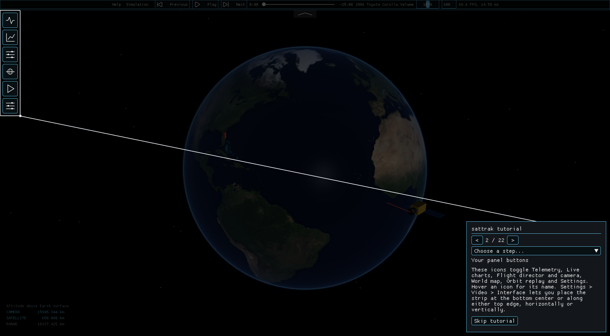
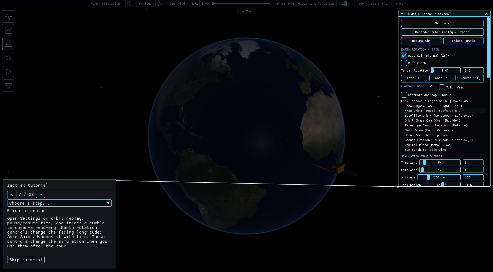
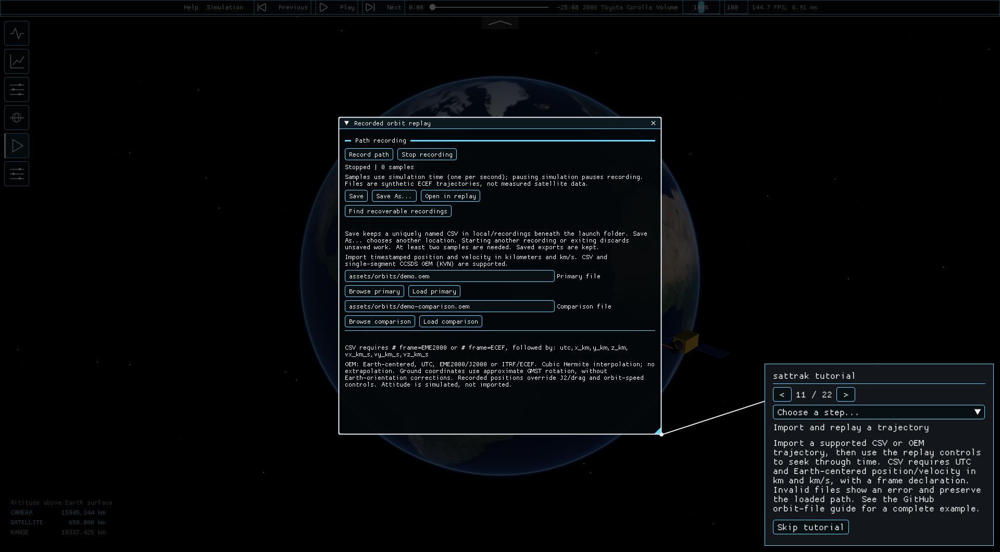
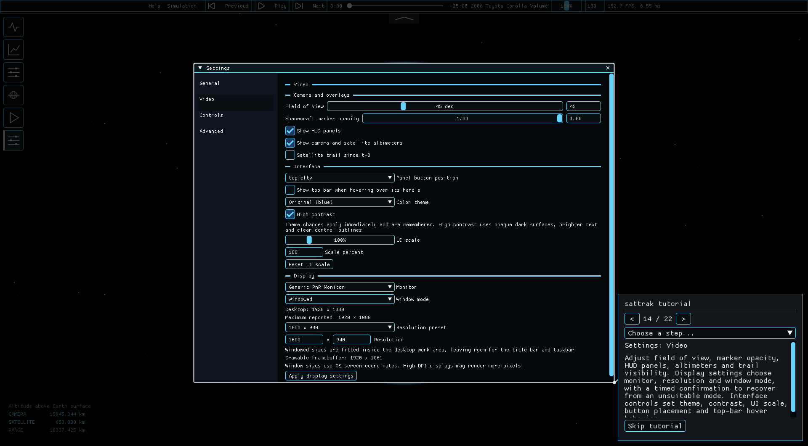
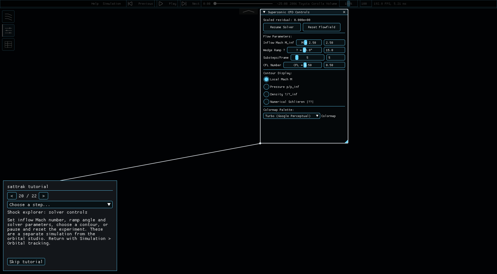

# Explore sattrak

- [Download the Windows installer](https://github.com/ExplodingWater/sattrak/releases/download/v1.0.0-preview.20261103/sattrak-1.0.0-windows-x64-setup.exe)
- [Release details](https://github.com/ExplodingWater/sattrak/releases/tag/v1.0.0-preview.20261103)

The guided tutorial starts on your first launch, after the satellite-data choice. Restart it from **Settings → General → Restart guided tutorial**.

Use **< 1 / 22 >** to move backward and forward, or **Choose a step…** to jump to a topic. **Skip tutorial** is always available; the final step offers **Finish tutorial**. The tour opens each panel and highlights it with a spotlight and a connecting line. It pauses the simulations and blocks changes to the controls while you read. Finishing or skipping restores your previous panel visibility, studio and paused/running state.

These are real screenshots captured from sattrak, not generated illustrations.

## Find your tools

The six icons toggle telemetry, live charts, the flight director, world map, orbit replay and Settings. Hover an icon to see its name. Change their placement in **Settings → Video → Interface**.

## Fly around Earth

Open the flight director to pause time, choose a camera or select a ground target. **Satellite Orbit** follows the spacecraft: left-drag rotates around it and the wheel changes distance. Outside panels, **WASD** moves, **Q/E** moves vertically, and **right-drag or arrow keys** looks around.

## Load or record a path

Orbit replay imports Earth-centered CSV or OEM trajectories. CSV needs UTC timestamps, a reference frame, position in kilometres and velocity in kilometres per second. [Read the format guide and error-handling notes](../assets/orbits/README.md)

Use **Record path**, **Stop recording**, then **Save** or **Save As** to retain a simulated path. Save before starting another recording or exiting. Comparison trajectories and ground-station pass calculations are also in this window.

## Make the interface yours

Settings has four categories: **General** for spacecraft, scale, sound and satellite data; **Video** for overlays, themes, UI scale and display; **Controls** for sensitivity, bindings and macros; **Advanced** for experimental simulation parameters. Display changes require confirmation and revert if you do not keep them.

## Commands and help

Press **backtick (`)** to open the console. Type `help`, use Up/Down to select suggestions, and Tab to complete them. **F10** opens help with keyboard-navigation instructions and a copyable text snapshot of the scene.

## Explore shocks

Open **Simulation → Tools → Supersonic shock explorer**. Its icon buttons show the flowfield, solver controls and analytical verification benchmark. Return through **Simulation → Orbital tracking**.

## Tour topics

| Steps | Topics |
| --- | --- |
| 1–4 | Welcome, panel buttons, top bar/music, collapse handle |
| 5–6 | Telemetry and live charts |
| 7–9 | Flight director, cameras/multiple views, time/orbit/targets |
| 10–12 | World map, trajectory imports, recording/comparison/passes |
| 13–16 | General, Video, Controls and Advanced settings |
| 17–18 | Console and accessibility/help |
| 19–21 | Shock flowfield, solver controls and verification |
| 22 | Finish and return to your workspace |

The dismissed/completed preference is per user: `%LOCALAPPDATA%\sattrak\tutorial-v1.txt` on Windows, or `$XDG_STATE_HOME/sattrak/tutorial-v1.txt` (otherwise `~/.local/state/sattrak/tutorial-v1.txt`) on Unix. The tour never enables internet access or changes simulation parameters for you.

## Developer verification

`Test_Tutorial_State` runs in CTest without OpenGL, including missing/corrupt state, skip/completion, Unicode paths and failed writes. `ag --tutorial-smoke-test` renders all 22 steps, verifies their target windows, tests bounds on navigation, skip/restart/finish and restoration, and captures real screenshots. Add `--compact` to exercise a 900×700 window at 150% UI scale. Smoke runs do not save the first-run preference.
